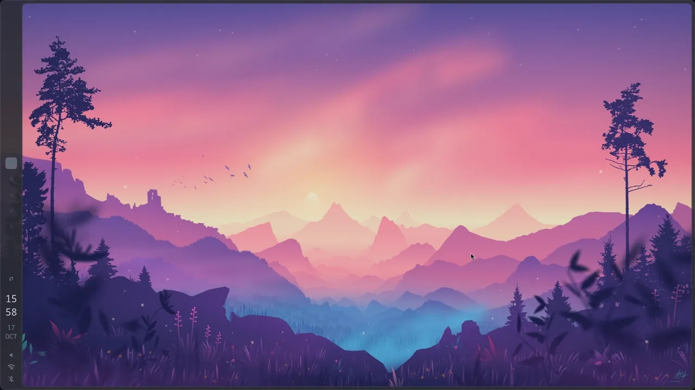

<div align="center">



<br>
<br>

[](https://hypr.land)
[](https://quickshell.org)
[](https://github.com/marcusbandit/banditshell/commits/main)
[](https://github.com/marcusbandit/banditshell/stargazers)
[](LICENSE)
[](https://ko-fi.com/marcusbandit)

</div>

<br>

<div align="center">

<br>
<sub><a href="docs/readme/hero.mp4">the same clip at 1080p</a></sub>
</div>

<br>

banditshell is a desktop shell for Hyprland, written from scratch in
[Quickshell](https://quickshell.org) and QML. While you work, nothing sits on
screen. A thin slate frame holds the wallpaper, and the rest comes out of that
frame when you reach for it, then goes back where it came from.

Everything is alive. Panels melt out of the frame as metaballs drawn in a
fragment shader, numbers glide to their new value instead of jumping, and the
text is set in Monocraft, a pixel font. I use it every day, so it changes
almost every day.

> [!NOTE]
> Arch Linux and Hyprland only, for now. This is a personal shell that a few
> other people run too. Things move around, and the What's new card tells you
> when they do.

> [!TIP]
> On Omarchy? The island runs there as a plugin:
> [banditshell island](https://github.com/marcusbandit/banditshell-island),
> listed on the [Omarchy plugin marketplace](https://omarchyplugins.com/plugin.html?id=banditshell.island).

## What's in it

- A launcher that answers as you type. Sums, units, dates and colours go
  through qalc. It finds open windows, emoji, your scripts, Wi-Fi networks and
  SSH hosts, translates and defines words, starts a pomodoro, and asks a local
  AI model through Ollama when you want one.
- The island at the top of the screen. A notification, a song change, a
  finished download, a kernel update waiting for a reboot: the newest takes
  the big spot and the rest wait as bubbles beside it.
- Settings that grow out of the sidebar, sorted into ten categories. Every
  page drives the real thing, from Wi-Fi and Bluetooth to monitors, sound,
  power and the night light schedule.
- A lock screen with your wallpaper blurred behind a large clock, media
  controls and power buttons you hold to confirm.
- Quick controls, a calendar, notifications with do not disturb, a clipboard
  history, a calculator and a media card. With Spotify, the media card shows
  word-timed lyrics.
- A wallpaper picker, bare mode that turns all of the chrome off at once, and
  a streamer mode with an OBS deck.
- A memory. Restart the shell and the panels you had open come back, Settings
  on the page you left it.
- Updates from the inside. The update menu fetches the new version, and the
  What's new card says what changed in plain words.

## Install

You need Arch Linux and Hyprland. The installer brings the rest: Quickshell,
the Monocraft font, every tool the shell calls, its small C helpers and tab
completion for zsh and bash. It asks for sudo only when a package needs
installing, and a second run retries only the steps that failed.

```sh
git clone https://github.com/marcusbandit/banditshell.git
cd banditshell
./install.sh
bin/banditshell start
```

`./install.sh --dry-run` walks every step without installing anything, and
`--list` prints the steps.

The first start links the command into `~/bin/banditshell`. To bring the shell
up with Hyprland, add it to your config:

```ini
exec-once = ~/bin/banditshell start
```

For keybinds, open Settings, go to About and let banditshell manage the binds.
It writes its own file and adds one line to `hyprland.lua`. If you would
rather wire them by hand, start from
[`docs/hyprland-binds.example.conf`](docs/hyprland-binds.example.conf).

## Driving it

Everything the shell does is a command. A keybind, a script and a terminal
all drive it the same way, and Tab completes every word.

```sh
banditshell panel launcher toggle
banditshell wallpaper next
banditshell clock timer start 10m
banditshell screen border off
banditshell help
```

`banditshell doctor` checks the setup, and `banditshell log` shows what the
shell has been saying.

## Updating

The update menu handles it. If an update touches a file you edited yourself,
your edit is set aside in `git stash` first and the menu names the file. From
a terminal, `git pull` and `banditshell restart` do the same.

## Credits

- [Quickshell](https://quickshell.org), the toolkit everything here is built on.
- [Hyprland](https://hypr.land), the compositor it lives in.
- [Monocraft](https://github.com/IdreesInc/Monocraft) by Idrees Hassan, the
  pixel font, and Google's
  [Material Symbols](https://fonts.google.com/icons) for the icons.
- [Spicy Lyrics](https://github.com/Spikerko/spicy-lyrics) and
  [Spicetify](https://spicetify.app), for the word-timed lyrics.
- [caelestia](https://github.com/caelestia-dots/shell), where this started.
  It is finished and excellent, and banditshell exists because I wanted to
  know how every part of a shell works. A few ideas came from it, the metaball
  frame first of all. The code is written here.

## Support

banditshell is free and stays free. If it made your desktop a little nicer
and you feel like buying me a coffee, there is a
[Ko-fi](https://ko-fi.com/marcusbandit). It is entirely optional, and a star
or a good bug report helps just as much.

<div align="center">

[](https://ko-fi.com/marcusbandit)

</div>

## Star history

<a href="https://star-history.com/#marcusbandit/banditshell&Date">
  <picture>
    <source media="(prefers-color-scheme: dark)" srcset="https://api.star-history.com/svg?repos=marcusbandit/banditshell&type=Date&theme=dark">
    <source media="(prefers-color-scheme: light)" srcset="https://api.star-history.com/svg?repos=marcusbandit/banditshell&type=Date">
    
  </picture>
</a>

## License

[GPL-3.0](LICENSE).
