# Dependency graph

Generated from the `module.json` manifests by `node scripts/check-modules.js --graph`; do not edit
it by hand. After a manifest changes, run
`node scripts/check-modules.js --graph > docs/architecture/dependency-graph.md`. A test fails while
this page is out of date. The rules behind it are in [modules.md](modules.md).

## Packages

39 packages. An arrow points from a package to one it requires; a dotted arrow is an
optional requirement. Arrows that a longer path already implies are left out, so a package also
reaches everything below its arrows.

```mermaid
flowchart BT
    core["core<br/><small>layer 0</small>"]
    compositor["compositor<br/><small>layer 1</small>"]
    apps["apps<br/><small>layer 2</small>"]
    audio["audio<br/><small>layer 2</small>"]
    capture["capture<br/><small>layer 2</small>"]
    cheatsheet["cheatsheet<br/><small>layer 2</small>"]
    clipboard["clipboard<br/><small>layer 2</small>"]
    clock["clock<br/><small>layer 2</small>"]
    display["display<br/><small>layer 2</small>"]
    files["files<br/><small>layer 2</small>"]
    media["media<br/><small>layer 2</small>"]
    network["network<br/><small>layer 2</small>"]
    password["password<br/><small>layer 2</small>"]
    pen["pen<br/><small>layer 2</small>"]
    wallpaper["wallpaper<br/><small>layer 2</small>"]
    bar["bar<br/><small>layer 3</small>"]
    calculator["calculator<br/><small>layer 3</small>"]
    keyboard["keyboard<br/><small>layer 3</small>"]
    launcher["launcher<br/><small>layer 3</small>"]
    notifications["notifications<br/><small>layer 3</small>"]
    quickcontrols["quickcontrols<br/><small>layer 3</small>"]
    settings["settings<br/><small>layer 3</small>"]
    stream["stream<br/><small>layer 3</small>"]
    windows["windows<br/><small>layer 3</small>"]
    launcher_ai["launcher-ai<br/><small>layer 4</small>"]
    launcher_devops["launcher-devops<br/><small>layer 4</small>"]
    launcher_system["launcher-system<br/><small>layer 4</small>"]
    launcher_tools["launcher-tools<br/><small>layer 4</small>"]
    power["power<br/><small>layer 4</small>"]
    tour["tour<br/><small>layer 4</small>"]
    updates["updates<br/><small>layer 4</small>"]
    host["host<br/><small>layer 5</small>"]
    island["island<br/><small>layer 5</small>"]
    launcher_online["launcher-online<br/><small>layer 5</small>"]
    lock["lock<br/><small>layer 5</small>"]
    screentime["screentime<br/><small>layer 5</small>"]
    session["session<br/><small>layer 5</small>"]
    events["events<br/><small>layer 6</small>"]
    launcher_shell["launcher-shell<br/><small>layer 6</small>"]
    compositor --> core
    apps --> compositor
    audio --> compositor
    capture --> compositor
    cheatsheet --> compositor
    clipboard --> compositor
    clock --> compositor
    display --> compositor
    files --> compositor
    media --> compositor
    network --> compositor
    password --> compositor
    pen --> compositor
    wallpaper --> compositor
    bar --> apps
    bar --> audio
    bar --> display
    bar --> network
    calculator --> network
    keyboard --> display
    launcher --> apps
    notifications --> apps
    quickcontrols --> audio
    quickcontrols --> display
    settings --> clock
    settings --> display
    stream --> apps
    stream --> audio
    stream --> network
    windows --> apps
    launcher_ai --> clipboard
    launcher_ai --> launcher
    launcher_devops --> files
    launcher_devops --> launcher
    launcher_system --> audio
    launcher_system --> capture
    launcher_system --> display
    launcher_system --> network
    launcher_system --> launcher
    launcher_tools --> clipboard
    launcher_tools --> clock
    launcher_tools --> files
    launcher_tools --> launcher
    launcher_tools --> notifications
    power --> compositor
    tour --> apps
    tour --> settings
    updates --> compositor
    host --> tour
    island -.-> capture
    island -.-> clipboard
    island --> clock
    island -.-> files
    island --> media
    island --> bar
    island --> calculator
    island --> notifications
    island -.-> updates
    launcher_online --> files
    launcher_online --> launcher
    lock --> clock
    lock --> media
    lock --> wallpaper
    lock --> notifications
    lock --> power
    screentime --> power
    session --> power
    events --> files
    events --> updates
    events --> host
    events --> island
    launcher_shell --> bar
    launcher_shell --> launcher_tools
    launcher_shell --> host
```

## Every package

The QML a package owns is a file or a folder and everything below it. Where the code reaches
further than its manifest allows, `node scripts/check-modules.js --explain <package>` shows it.

| package | layer | summary | owns QML | requires | required by |
|---|---|---|---|---|---|
| core | 0 | config singletons, theme tokens, generic components and the controls kit | `config`, `modules/cli.js`, `modules/controls`, `modules/gallery`, `modules/ipc/CoreIpc.qml`, `modules/ipc/TraceIpc.qml`, `modules/panel`, `previews/GalleryPreview.qml`, `previews/QrPreview.qml`, `services/LevelCover.qml`, `services/qmldir`, `services/FileDialogs.qml`, `services/Focus.qml`, `services/Lookup.qml`, `services/Notify.qml`, `services/Panels.qml`, `services/Polkit.qml`, `services/PrivateFile.qml`, `services/Prompts.qml`, `services/Relaunch.qml`, `services/SessionControl.qml`, `services/System.qml`, `services/SystemBinaries.qml`, `services/TimeFormat.qml`, `services/ToolInstaller.qml`, `services/Tooltips.qml`, `services/Trace.qml` | none | compositor, apps, audio, capture, cheatsheet, clipboard, clock, display, files, media, network, password, pen, wallpaper, bar, calculator, keyboard, launcher, notifications, quickcontrols, settings, stream, windows, launcher-ai, launcher-devops, launcher-system, launcher-tools, power, tour, updates, host, island, launcher-online, lock, screentime, session, events, launcher-shell |
| compositor | 1 | the Hyprland bridge: windows, monitors, config files, chords | `modules/ipc/CompositorIpc.qml`, `services/CliMigration.qml`, `services/CompositorSync.qml`, `services/Hypr.qml`, `services/HyprConfig.qml`, `services/Keymap.qml`, `services/Monitors.qml`, `services/WorkspaceSlide.qml` | core | apps, audio, capture, cheatsheet, clipboard, clock, display, files, media, network, password, pen, wallpaper, bar, calculator, keyboard, launcher, notifications, quickcontrols, settings, stream, windows, launcher-ai, launcher-devops, launcher-system, launcher-tools, power, tour, updates, host, island, launcher-online, lock, screentime, session, events, launcher-shell |
| apps | 2 | installed applications, launching and startup apps | `services/AppIcons.qml`, `services/Apps.qml`, `services/DefaultApps.qml`, `services/DesktopIndex.qml`, `services/LauncherMemory.qml`, `services/Launching.qml`, `services/StartupApps.qml` | core, compositor | bar, launcher, notifications, stream, windows, tour, island, launcher-online |
| audio | 2 | audio devices and Bluetooth | `modules/ipc/AudioIpc.qml`, `services/Audio.qml`, `services/Bluetooth.qml` | core, compositor | bar, quickcontrols, stream, launcher-system, island |
| capture | 2 | screen recording and region picking | `modules/picker`, `services/ScreenRecorder.qml`, `services/Screenshots.qml` | core, compositor | launcher-system, island |
| cheatsheet | 2 | the hotkey cheat sheet and keyboard models | `modules/cheatsheet`, `services/Keyboards.qml` | core, compositor | none |
| clipboard | 2 | clipboard history and dictation | `modules/clipboard`, `services/Clipboard.qml`, `services/Dictation.qml` | core, compositor | launcher-ai, launcher-tools, island, launcher-shell |
| clock | 2 | timers, alarms, world clocks and weather | `modules/ipc/ClockIpc.qml`, `services/Clock.qml`, `services/Localisation.qml`, `services/Weather.qml` | core, compositor | settings, launcher-tools, island, lock |
| display | 2 | brightness, night light, dark mode and tablet state | `modules/ipc/DisplayIpc.qml`, `services/Backlight.qml`, `services/DarkMode.qml`, `services/Display.qml`, `services/Tablet.qml` | core, compositor | bar, keyboard, quickcontrols, settings, launcher-system, island |
| files | 2 | the file browser and its terminal | `modules/files`, `previews/FilesPreview.qml`, `previews/TerminalDebug.qml`, `services/Downloads.qml`, `services/Files.qml`, `services/FilesFind.qml`, `services/FilesPaste.qml`, `services/FilesUndo.qml` | core, compositor | launcher-devops, launcher-tools, island, launcher-online, events, launcher-shell |
| media | 2 | media players, lyrics and the player widgets | `modules/media`, `services/Lyrics.qml`, `services/Media.qml` | core, compositor | island, lock, events |
| network | 2 | network, hotspot, tunnels and Tailscale | `services/Hotspot.qml`, `services/Network.qml`, `services/NetworkEvents.qml`, `services/Tailscale.qml`, `services/Tunnels.qml`, `services/WifiJoin.qml` | core, compositor | bar, calculator, stream, launcher-system, island |
| password | 2 | the keyring and polkit password prompts | `modules/password`, `services/Keyring.qml`, `services/PasswordRequest.qml` | core, compositor | none |
| pen | 2 | pen mapping and pen buttons | `modules/pen`, `services/PenButtons.qml`, `services/PenMap.qml` | core, compositor | none |
| wallpaper | 2 | the wallpaper, its picker and palette | `modules/wallpaper`, `services/Wallpaper.qml` | core, compositor | lock |
| bar | 3 | the sidebar, status icons and menus | `modules/menu`, `modules/sidebar`, `previews/SidebarPreview.qml`, `services/SidebarState.qml`, `services/Tray.qml` | core, compositor, apps, audio, display, network | island, launcher-shell |
| calculator | 3 | the calculator and currency rates | `modules/calculator`, `previews/CalculatorPreview.qml`, `services/Calculator.qml`, `services/Currency.qml` | core, compositor, network | island |
| keyboard | 3 | the on-screen keyboard | `modules/keyboard`, `services/Keystrokes.qml` | core, compositor, display | none |
| launcher | 3 | the launcher: search, concepts, edge and hotkeys | `modules/launcher/AlphabetLauncher.qml`, `modules/launcher/AlphabetRow.qml`, `modules/launcher/AnswerRow.qml`, `modules/launcher/ColourPicker.qml`, `modules/launcher/LaunchEdge.qml`, `modules/launcher/Launcher.qml`, `modules/launcher/LauncherConcept.qml`, `modules/launcher/LauncherIpc.qml`, `modules/launcher/LauncherSearch.qml`, `modules/launcher/ListLauncher.qml`, `modules/launcher/Peek.qml`, `modules/launcher/module.json`, `modules/launcher/placement.js`, `modules/launcher/prefixes.js`, `modules/launcher/qmldir`, `modules/launcher/search.js`, `modules/launcher/shellcli.js`, `modules/launcher/sources/FallbackSource.qml`, `modules/launcher/sources/MediaSource.qml`, `modules/launcher/sources/PrefixSource.qml`, `modules/launcher/sources/qmldir`, `modules/launcher/system-asks.js`, `services/LauncherHotkeys.qml` | core, compositor, apps | launcher-ai, launcher-devops, launcher-system, launcher-tools, launcher-online, launcher-shell |
| notifications | 3 | the notification server, history and popups | `modules/ipc/NotificationsIpc.qml`, `modules/notifications`, `previews/NotificationPreview.qml`, `services/AlertSounds.qml`, `services/AppNotifications.qml`, `services/NotificationBrief.qml`, `services/NotificationEntry.qml`, `services/Notifications.qml` | core, compositor, apps | launcher-tools, island, lock, events |
| quickcontrols | 3 | the quick controls panel | `modules/quickcontrols`, `previews/QuickControlsPreview.qml` | core, compositor, audio, display | none |
| settings | 3 | the settings panel | `modules/settings`, `previews/SettingsPreview.qml`, `services/Modes.qml`, `services/Settings.qml`, `services/ThemeSwitcher.qml` | core, compositor, clock, display | tour, events |
| stream | 3 | streamer mode and OBS | `modules/stream`, `services/Obs.qml`, `services/ObsLink.qml`, `services/StreamState.qml` | core, compositor, apps, audio, network | none |
| windows | 3 | window previews, tiling layouts and the layout workshop | `modules/windows`, `modules/workshop`, `previews/WindowPreview.qml`, `services/LayoutDraft.qml`, `services/WindowLayouts.qml`, `services/WorkshopLayouts.qml` | core, compositor, apps | none |
| launcher-ai | 4 | the launcher's assistant sources | `modules/launcher/AssistantCard.qml`, `modules/launcher/sources/AskSource.qml`, `modules/launcher/sources/RewriteSource.qml`, `services/Assistant.qml` | core, compositor, clipboard, launcher | none |
| launcher-devops | 4 | the launcher's developer operations sources | `modules/launcher/sources/ContainerSource.qml`, `modules/launcher/sources/MonitorSource.qml`, `modules/launcher/sources/PhoneSource.qml`, `modules/launcher/sources/PortSource.qml`, `modules/launcher/sources/ServiceSource.qml`, `modules/launcher/sources/SshSource.qml`, `services/Containers.qml`, `services/Device.qml`, `services/ListeningPorts.qml`, `services/Phone.qml`, `services/SshHosts.qml`, `services/SystemInfo.qml`, `services/SystemMonitor.qml`, `services/SystemdUnits.qml` | core, compositor, files, launcher | none |
| launcher-system | 4 | the launcher's system control sources | `modules/launcher/sources/BrightnessSource.qml`, `modules/launcher/sources/RecordSource.qml`, `modules/launcher/sources/SoundSource.qml`, `modules/launcher/sources/VpnSource.qml`, `modules/launcher/sources/WifiSource.qml`, `modules/launcher/sources/WorkshopSource.qml` | core, compositor, audio, capture, display, network, launcher | none |
| launcher-tools | 4 | the launcher's power tools, typing and utility sources | `modules/launcher/sources/ClipboardSource.qml`, `modules/launcher/sources/ColourSource.qml`, `modules/launcher/sources/DevSource.qml`, `modules/launcher/sources/EmojiSource.qml`, `modules/launcher/sources/LatestSource.qml`, `modules/launcher/sources/LoremSource.qml`, `modules/launcher/sources/NotesSource.qml`, `modules/launcher/sources/NotificationSource.qml`, `modules/launcher/sources/PomodoroSource.qml`, `modules/launcher/sources/ProjectSource.qml`, `modules/launcher/sources/QuicklinkSource.qml`, `modules/launcher/sources/ScriptSource.qml`, `modules/launcher/sources/SnippetSource.qml`, `modules/launcher/sources/TimerSource.qml`, `services/ColourPicks.qml`, `services/DevUtilities.qml`, `services/Emoji.qml`, `services/FileSearch.qml`, `services/LatestFiles.qml`, `services/Notes.qml`, `services/Pomodoro.qml`, `services/Projects.qml`, `services/ScriptCommands.qml`, `services/Snippets.qml`, `services/Typist.qml` | core, compositor, clipboard, clock, files, launcher, notifications | launcher-shell |
| power | 4 | battery, charge limit, power profile, lid and idle | `previews/BatteryPreview.qml`, `services/Battery.qml`, `services/ChargeLimit.qml`, `services/Idle.qml`, `services/Lid.qml`, `services/Power.qml`, `services/PowerProfile.qml`, `services/Suspension.qml` | core, compositor | lock, screentime, session |
| tour | 4 | the first-run tour over the real desktop | `modules/tour`, `services/Tour.qml` | core, compositor, apps, settings | host |
| updates | 4 | update checks, pacman and what's new | `services/Pacman.qml`, `services/SystemUpgrade.qml`, `services/Update.qml`, `services/WhatsNew.qml` | core, compositor | island, events |
| host | 5 | the shell window, chassis, window registry and the IPC front | `modules/BandProgress.qml`, `modules/Chassis.qml`, `modules/FrameExclusions.qml`, `modules/FullscreenBorder.qml`, `modules/Ipc.qml`, `modules/ShellWindow.qml`, `modules/Tooltip.qml`, `modules/ipc/HostIpc.qml`, `modules/ipc/qmldir`, `modules/qmldir`, `preview.qml`, `previews/qmldir`, `shell.qml`, `services/Shell.qml` | core, compositor, tour | events, launcher-shell |
| island | 5 | the dynamic island and its activities | `modules/island`, `previews/IslandPreview.qml`, `services/Activities.qml`, `services/Levels.qml`, `services/Moments.qml`, `services/Notices.qml`, `services/Privacy.qml` | core, compositor, apps, audio, capture, clipboard, clock, display, files, media, network, bar, calculator, notifications, updates | events |
| launcher-online | 5 | the launcher's online sources | `modules/launcher/sources/BrowserSource.qml`, `modules/launcher/sources/DefineSource.qml`, `modules/launcher/sources/DefinitionHeading.qml`, `modules/launcher/sources/DefinitionSense.qml`, `modules/launcher/sources/GithubSource.qml`, `modules/launcher/sources/PackageSource.qml`, `modules/launcher/sources/SpeedtestSource.qml`, `modules/launcher/sources/TranslateSource.qml`, `modules/launcher/sources/VideoDownloadSource.qml`, `modules/launcher/sources/WordView.qml`, `services/BrowserPlaces.qml`, `services/Dictionary.qml`, `services/GitHub.qml`, `services/PackageSearch.qml`, `services/SpeedTest.qml`, `services/Translator.qml`, `services/Uninstaller.qml`, `services/VideoDownloads.qml` | core, compositor, apps, files, launcher | none |
| lock | 5 | the lock screen | `modules/lock`, `previews/LockPreview.qml`, `services/Lock.qml` | core, compositor, clock, media, wallpaper, notifications, power | none |
| screentime | 5 | screen time usage and limits | `services/Usage.qml`, `services/UsageApps.qml`, `services/UsageLimits.qml` | core, compositor, power | none |
| session | 5 | the session power panel | `modules/session` | core, compositor, power | none |
| events | 6 | the event stream that banditshell events follows | `services/Events.qml` | core, compositor, files, media, notifications, settings, updates, host, island | none |
| launcher-shell | 6 | the launcher's sources for the shell's own state: keybinds, tray, special workspaces, actions and recent documents | `modules/launcher/sources/ActionsSource.qml`, `modules/launcher/sources/KeysSource.qml`, `modules/launcher/sources/RecentSource.qml`, `modules/launcher/sources/TraySource.qml`, `modules/launcher/sources/WorkspaceSource.qml`, `services/RecentDocuments.qml`, `services/ShellActions.qml` | core, compositor, clipboard, files, bar, launcher, launcher-tools, host | none |
