# Dependency graph

Generated by `banditshell dev modules --graph` from the `module.json` manifests and a scan of the
code. Do not edit it by hand; after a manifest or an import changes, run
`banditshell dev modules --graph > docs/architecture/dependency-graph.md`. A test fails while this
page is out of date. The rules behind it are in [modules.md](modules.md).

## Packages

38 packages, 532 QML files. An arrow points from a package to one it
requires; a dotted arrow is an optional requirement. Arrows that a longer path already implies are
left out, so every package also reaches everything below its arrows.

```mermaid
flowchart BT
    core["core<br/><small>layer 0, 91 qml</small>"]
    compositor["compositor<br/><small>layer 1, 8 qml</small>"]
    apps["apps<br/><small>layer 2, 7 qml</small>"]
    audio["audio<br/><small>layer 2, 3 qml</small>"]
    capture["capture<br/><small>layer 2, 6 qml</small>"]
    cheatsheet["cheatsheet<br/><small>layer 2, 7 qml</small>"]
    clipboard["clipboard<br/><small>layer 2, 6 qml</small>"]
    clock["clock<br/><small>layer 2, 4 qml</small>"]
    display["display<br/><small>layer 2, 5 qml</small>"]
    files["files<br/><small>layer 2, 22 qml</small>"]
    host["host<br/><small>layer 2, 11 qml</small>"]
    media["media<br/><small>layer 2, 13 qml</small>"]
    network["network<br/><small>layer 2, 6 qml</small>"]
    password["password<br/><small>layer 2, 4 qml</small>"]
    pen["pen<br/><small>layer 2, 4 qml</small>"]
    settings["settings<br/><small>layer 2, 106 qml</small>"]
    wallpaper["wallpaper<br/><small>layer 2, 7 qml</small>"]
    bar["bar<br/><small>layer 3, 35 qml</small>"]
    calculator["calculator<br/><small>layer 3, 5 qml</small>"]
    keyboard["keyboard<br/><small>layer 3, 5 qml</small>"]
    launcher["launcher<br/><small>layer 3, 14 qml</small>"]
    notifications["notifications<br/><small>layer 3, 12 qml</small>"]
    quickcontrols["quickcontrols<br/><small>layer 3, 3 qml</small>"]
    stream["stream<br/><small>layer 3, 5 qml</small>"]
    windows["windows<br/><small>layer 3, 12 qml</small>"]
    launcher_ai["launcher-ai<br/><small>layer 4, 4 qml</small>"]
    launcher_devops["launcher-devops<br/><small>layer 4, 14 qml</small>"]
    launcher_system["launcher-system<br/><small>layer 4, 6 qml</small>"]
    launcher_tools["launcher-tools<br/><small>layer 4, 25 qml</small>"]
    power["power<br/><small>layer 4, 8 qml</small>"]
    updates["updates<br/><small>layer 4, 4 qml</small>"]
    island["island<br/><small>layer 5, 29 qml</small>"]
    launcher_online["launcher-online<br/><small>layer 5, 18 qml</small>"]
    launcher_shell["launcher-shell<br/><small>layer 5, 7 qml</small>"]
    lock["lock<br/><small>layer 5, 10 qml</small>"]
    screentime["screentime<br/><small>layer 5, 3 qml</small>"]
    session["session<br/><small>layer 5, 2 qml</small>"]
    events["events<br/><small>layer 6, 1 qml</small>"]
    compositor --> core
    apps --> compositor
    audio --> compositor
    capture --> compositor
    cheatsheet --> compositor
    clipboard --> compositor
    clock --> compositor
    display --> compositor
    files --> compositor
    host --> compositor
    media --> compositor
    network --> compositor
    password --> compositor
    pen --> compositor
    settings --> compositor
    wallpaper --> compositor
    bar --> apps
    bar --> audio
    bar --> display
    bar --> network
    calculator --> network
    keyboard --> display
    launcher --> apps
    notifications --> apps
    quickcontrols --> audio
    quickcontrols --> display
    stream --> apps
    stream --> audio
    stream --> network
    windows --> apps
    launcher_ai --> clipboard
    launcher_ai --> launcher
    launcher_devops --> files
    launcher_devops --> launcher
    launcher_system --> audio
    launcher_system --> capture
    launcher_system --> display
    launcher_system --> network
    launcher_system --> launcher
    launcher_tools --> clipboard
    launcher_tools --> clock
    launcher_tools --> files
    launcher_tools --> launcher
    launcher_tools --> notifications
    power --> compositor
    updates --> compositor
    island -.-> capture
    island -.-> clipboard
    island --> clock
    island -.-> files
    island --> media
    island --> bar
    island --> calculator
    island --> notifications
    island -.-> updates
    launcher_online --> files
    launcher_online --> launcher
    launcher_shell --> host
    launcher_shell --> bar
    launcher_shell --> launcher_tools
    lock --> clock
    lock --> media
    lock --> wallpaper
    lock --> notifications
    lock --> power
    screentime --> power
    session --> power
    events --> host
    events --> settings
    events --> island
```

## Every package

Requires and required by come from the manifests. The last column lists packages the code reaches
for without its manifest allowing it yet; those reaches are recorded in `modules.baseline.json`
and shrink as the split goes on.

| package | layer | summary | qml | requires | required by | reaches without leave |
|---|---|---|---|---|---|---|
| core | 0 | config singletons, theme tokens, generic components and the controls kit | 91 | none | compositor, apps, audio, capture, cheatsheet, clipboard, clock, display, files, host, media, network, password, pen, settings, wallpaper, bar, calculator, keyboard, launcher, notifications, quickcontrols, stream, windows, launcher-ai, launcher-devops, launcher-system, launcher-tools, power, updates, island, launcher-online, launcher-shell, lock, screentime, session, events | compositor, apps, host, bar, island |
| compositor | 1 | the Hyprland bridge: windows, monitors, config files, chords | 8 | core | apps, audio, capture, cheatsheet, clipboard, clock, display, files, host, media, network, password, pen, settings, wallpaper, bar, calculator, keyboard, launcher, notifications, quickcontrols, stream, windows, launcher-ai, launcher-devops, launcher-system, launcher-tools, power, updates, island, launcher-online, launcher-shell, lock, screentime, session, events | apps |
| apps | 2 | installed applications, launching and startup apps | 7 | core, compositor | bar, launcher, notifications, stream, windows, island, launcher-online | audio, network, settings |
| audio | 2 | audio devices and Bluetooth | 3 | core, compositor | bar, quickcontrols, stream, launcher-system, island | none |
| capture | 2 | screen recording and region picking | 6 | core, compositor | launcher-system, island | stream |
| cheatsheet | 2 | the hotkey cheat sheet and keyboard models | 7 | core, compositor | none | host |
| clipboard | 2 | clipboard history and dictation | 6 | core, compositor | launcher-ai, launcher-tools, island, launcher-shell | host |
| clock | 2 | timers, alarms, world clocks and weather | 4 | core, compositor | launcher-tools, island, lock | network |
| display | 2 | brightness, night light, dark mode and tablet state | 5 | core, compositor | bar, keyboard, quickcontrols, launcher-system, island | clock |
| files | 2 | the file browser and its terminal | 22 | core, compositor | launcher-devops, launcher-tools, island, launcher-online, launcher-shell, events | none |
| host | 2 | the shell window, chassis, window registry and the IPC front | 11 | core, compositor | launcher-shell, events | apps, audio, capture, cheatsheet, clipboard, clock, display, files, media, password, pen, settings, wallpaper, bar, calculator, keyboard, launcher, notifications, quickcontrols, stream, windows, launcher-ai, power, updates, island, lock, screentime, session, events |
| media | 2 | media players, lyrics and the player widgets | 13 | core, compositor | island, lock, events | apps, audio, host |
| network | 2 | network, hotspot, tunnels and Tailscale | 6 | core, compositor | bar, calculator, stream, launcher-system | password |
| password | 2 | the keyring and polkit password prompts | 4 | core, compositor | none | none |
| pen | 2 | pen mapping and pen buttons | 4 | core, compositor | none | none |
| settings | 2 | the settings panel | 106 | core, compositor | events | apps, audio, cheatsheet, clipboard, clock, display, files, host, network, pen, wallpaper, bar, calculator, notifications, stream, windows, launcher-ai, launcher-devops, launcher-tools, power, updates, screentime |
| wallpaper | 2 | the wallpaper, its picker and palette | 7 | core, compositor | lock | host |
| bar | 3 | the sidebar, status icons and menus | 35 | core, compositor, apps, audio, display, network | island, launcher-shell | capture, clock, host, media, calculator, notifications, power, updates, screentime |
| calculator | 3 | the calculator and currency rates | 5 | core, compositor, network | island | host, bar |
| keyboard | 3 | the on-screen keyboard | 5 | core, compositor, display | none | host |
| launcher | 3 | the launcher: search, concepts, edge and hotkeys | 14 | core, compositor, apps | launcher-ai, launcher-devops, launcher-system, launcher-tools, launcher-online, launcher-shell | audio, clipboard, clock, display, files, host, media, network, settings, calculator, notifications, windows, launcher-ai, launcher-devops, launcher-system, launcher-tools, power, launcher-online, launcher-shell |
| notifications | 3 | the notification server, history and popups | 12 | core, compositor, apps | launcher-tools, island, lock, events | host, island |
| quickcontrols | 3 | the quick controls panel | 3 | core, compositor, audio, display | none | host |
| stream | 3 | streamer mode and OBS | 5 | core, compositor, apps, audio, network | none | power |
| windows | 3 | window previews, tiling layouts and the layout workshop | 12 | core, compositor, apps | none | settings |
| launcher-ai | 4 | the launcher's assistant sources | 4 | core, compositor, clipboard, launcher | none | files, settings, keyboard |
| launcher-devops | 4 | the launcher's developer operations sources | 14 | core, compositor, files, launcher | none | apps, clipboard, launcher-tools, power |
| launcher-system | 4 | the launcher's system control sources | 6 | core, compositor, audio, capture, display, network, launcher | none | apps, settings, windows |
| launcher-tools | 4 | the launcher's power tools, typing and utility sources | 25 | core, compositor, clipboard, clock, files, launcher, notifications | launcher-shell | apps, settings, keyboard, stream |
| power | 4 | battery, charge limit, power profile, lid and idle | 8 | core, compositor | lock, screentime, session | bar |
| updates | 4 | update checks, pacman and what's new | 4 | core, compositor | island, events | none |
| island | 5 | the dynamic island and its activities | 29 | core, compositor, apps, audio, capture, clipboard, clock, display, files, media, bar, calculator, notifications, updates | events | host, wallpaper |
| launcher-online | 5 | the launcher's online sources | 18 | core, compositor, apps, files, launcher | none | none |
| launcher-shell | 5 | the launcher's sources for the shell's own state: keybinds, tray, special workspaces, actions and recent documents | 7 | core, compositor, clipboard, files, host, bar, launcher, launcher-tools | none | none |
| lock | 5 | the lock screen | 10 | core, compositor, clock, media, wallpaper, notifications, power | none | none |
| screentime | 5 | screen time usage and limits | 3 | core, compositor, power | none | none |
| session | 5 | the session power panel | 2 | core, compositor, power | none | host |
| events | 6 | the event stream that banditshell events follows | 1 | core, compositor, files, host, media, settings, notifications, updates, island | none | none |

